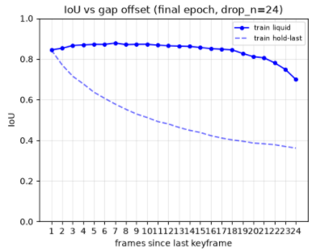

# Liquid Tracking Pipeline

## Abstract
This project combines a foundational object detector with a lightweight Liquid NCP tracker to reduce the inference processing cost. (It should be noted that for demonstrative purposes a simple YOLO tracker has been selected as the foundational model. However, this does not exclude deployment of more complex models.) The main reason for using the Liquid layer is to reduce the computational burden of foundational models, i.e., instead of running a heavy detector on every frame, the detector runs on selected keyframes and the Liquid model predicts object motion between them.

## Training Phase
Training teaches the Liquid tracker to recover objects' motion when detector outputs are intentionally dropped:

1. Decode training videos frame by frame. (For this POC, test videos from `Kaggle's Videos for object tracking` dataset have been used.)
2. Run the foundation detector on frames to get object center and confidence.
3. Link detections into object tracks over time.
4. Build training windows, then drop detector frames using the following pattern:
   - Keep `m` real detector frames. The goal here is to deduce the dynamic of the motion based on the last `m` frames.
   - Drop and predict the next `n` frames, using the Liquid layer
5. Train the Liquid stack to predict the residual missing boxes from recent motion context, where the initial point is the last known detector position.
6. Compare predicted boxes with detector targets, using weighted MSE and CIoU, and save checkpoints.

Program offers, different modes of training, including gradual learning from 1 frame to a specified number, in given step sizes.
The following figure represent a typical training run.

It is noted that for a simple Liquid layer, IoU of above 80% is maintained for for up to 20 frames.

## Inference Phase
Inference applies the learned tracker to reduce the number of detector calls.

1. For keyframes, run detector and refresh tracked objects.
2. For non-keyframes, feed the previous state to Liquid and predict the next position.
3. Draw overlays on output video, for both hold-last, HL, and Liquid, LQ, layers. Note that during the inference phase, neither the number of input frames, `keep-m`, nor the missing frames, `drop-n`, need to be identical to the training model. This indicates the ability of the liquid layer to generalize its learned parameters and objective. 
4. Write processed frames to an output video.

A sample run with model trained with `keep_m=4` and `drop_n=24`, and inference using `keep_m=4` and `drop_n=64`, is included in the root directory, sample_tracked_4_64.mp4

## Concluding Remarks
Choose `keep_m` (`m`) and `drop_n` (`n`) carefully based on temporal activity in your videos.

- Low-motion, smooth scenes: larger `n` is usually acceptable (fewer detector runs).
- Fast motion, abrupt direction changes, or occlusions: use smaller `n` and/or larger `m` for stability.
- Start conservative, then increase `n` gradually while monitoring IoU/recovery metrics.

The best trade off is task-dependent: tune `m` and `n` for your scene dynamics and latency/accuracy goals.
